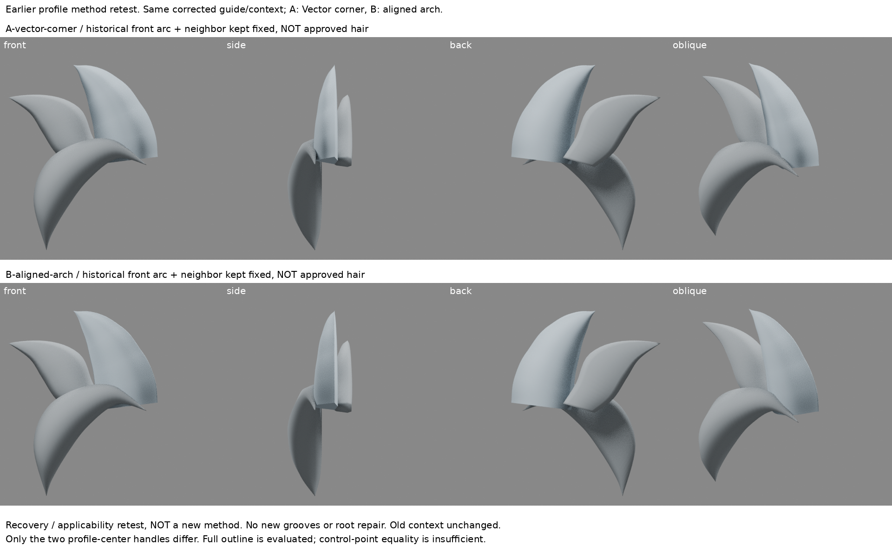
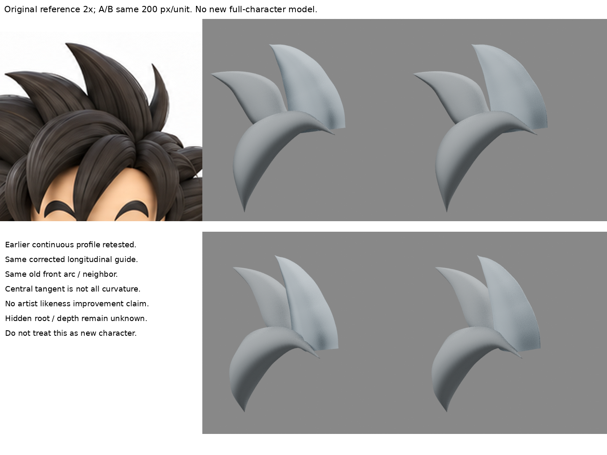

# 回做完整拱面截面：在修後導向與前弧上下文仍有效

2026-10-30 16:06（Asia/Taipei）。**早期方法恢復／適用性回測，不是新發明，也不是新完整髮型。** 本輪有新A/B局部實渲；iteration04不變。

## 問題與讀回
讀LEARNING_INDEX、ridge-curvature-diagnostic、ridge-transition-band、visible-plane-balance、bevel-profile-handles。多邊形脊附近新增倒角面帶後，最終轉向反集中；不是忘記Shade Smooth。不能再掃段數/寬度。本輪回到曾有效的原生截面中央共線柄，問它在已修正縱向導向、加入前弧與鄰束上下文後是否仍有效，並實查輪廓。這是使用者要求的早期方法回做，不把已知柔化又列新發現。

## 實際重新讀看
- stjun〈Blenderで髪の毛を作る〉3.1–3.3： https://stjun.hatenablog.com/entry/2022/02/27/190000 。重新讀正文，實看作者單拱／較平背的完整截面與長髮束圖（20220227160236，取自既存私人來源檔）。作者以導向曲線與自訂截面建束，再修改截面；此處只取單拱主面，不加波紋或細束。是側分下垂髮例，非本案尖髮完整配方；沒看嵌入影片。
- Blender4.3 Structure之Handle Types： https://docs.blender.org/manual/en/4.3/modeling/curves/structure.html 。web工具402；公開HTTP讀到正文，實讀Automatic、Vector、Aligned、Free。Vector可產生直線/尖角，Aligned兩柄共線而無尖角。沒有把共線當成曲率C2或全束表面保證。
第三方圖不入實驗包或公開庫。本文為有限方法摘要，不重製教材。

## 回測設計與新舊差別
從curve-speed-continuity/B-equal-speed.blend原樣複製：保留CARDINAL半徑與已等速的第4導向結點，未重做半徑或導向搜尋。

- A-vector-corner：只把截面凸側中央兩柄設為Vector。
- B-aligned-arch：原有中央共線Aligned柄保留，完整截面位置、導向、半徑、Tilt均不動。
- 兩版共同加入visible-plane-balance的歷史前弧與鄰束，同位置與材料；它們是未通過造型的舊上下文，不是新增束遮錯。兩版都沒有球治具，沒有根修復。
- 同480px／200px每單位正側背斜渲染。同一前視另單獨渲主束alpha查實際外輪廓。
- 與02:06的profile-handles是同一截面機制；新增的是修後縱向狀態與分層上下文的適用性／恢復證據。
- 與07:06多邊形倒角只作方法脈絡，不作單變因優劣結論，因表示法、導向與截面不同。

## 實際結果
四向實看：B正/斜視中央明暗從A的窄折帶轉為較連續寬拱面；這重現早期方法，不是新學到「共線可以柔化」。前弧遮擋沒有使該作用消失。側面仍看到平切根帽與舊上下文錯形，不能宣稱根已自然、整體更像原圖。背面截面平背與側角仍在，不是所有角都平滑。

正視主束alpha閾值128：22856個聯集像素，A/B異或0、最大逐行邊緣差0像素。**只證明這個固定前視、解析度、閾值下的剪影相同**，不證明所有視角／3D表面相同；截面變更本就會改可見表面。原圖同尺度比較只看可見輪廓與層次，根深仍未知，沒有原圖相似度通過主張。

原生A/B冷讀成功，導向、截面控制點、上下文、半徑插值相同；僅凸側中央柄不同。可保留B作「連續截面工具基線」，不升級完整角色基線。

## 學會、限制與下一步
- 恢復證據：早期方法可從保存的原生曲線重新打開、帶入新的可見上下文並重渲，沒有只靠摘要記憶。
- 適用範圍：需要完整單拱主面時，直接設計截面切線比在多邊形尖脊旁加窄帶更容易表達意圖；這是本案比較後的選擇，不是所有模型皆如此。
- 仍未知：單拱可能太均勻，如何沿長度改寬面朝向而不擾動外緣與出現橫帶；側/根/前弧仍未達目標。不能因恢復成功就開始加細槽或整頭複製。
- 下一步先保留這個連續拱面工具基線，研究主束沿長度的寬面朝向與不等寬分層，使用原圖可見資訊；不退回倒角／半徑掃描，不把隱藏根深定為真值。

## 恢復
source-input含導向/截面原生模型、上下文模型及授權原圖。build.py重建A/B及真渲，boards.py只排版與alpha比較，verify.py冷讀查必要物件及共同狀態。模型與圖已實際產出，未聲稱解壓到其他路徑完整重跑通過。第三方媒體不入包。原iteration04 SHA256為35cd1b71c9d288029d93d0fdb8d9741d62a5151bc3bc459ab48c789092b5aaa6，未變。GitHub只讀／待原核准，未寫入或重試。

## 實際渲染與公開範圍

公開版僅含本筆記與兩張新實渲比較板；原生輸入模型、重建及驗證腳本未隨附，私人恢復包另存。冷讀成功不等於異地解壓完整重跑已驗證。本地待同步，不代表遠端已發布。
